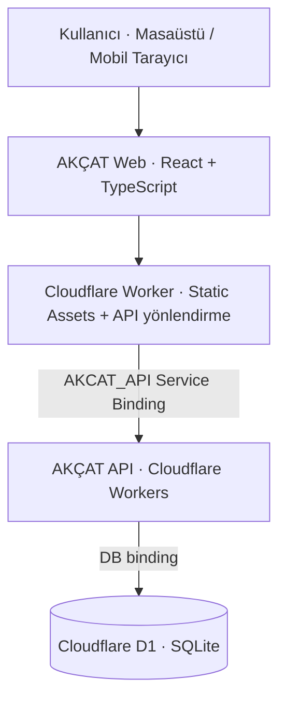

<div align="center">
  

  <h1>AKÇAT</h1>
  <p><strong>Su dağıtım işletmeleri için sade, hızlı ve güvenilir operasyon yönetimi.</strong></p>
  <p>Müşterilerden satışlara, tahsilatlardan veresiye takibine kadar günlük işlerin tek bir yerde yönetildiği, mobil uyumlu web uygulaması.</p>

  <p>
    
    
    
    
    
  </p>
</div>

---

## AKÇAT nedir?

AKÇAT, damacana su dağıtımı yapan küçük ölçekli işletmelerin günlük operasyonlarını dijital ortamda takip edebilmesi için geliştirilen bir **iş yönetim sistemidir**.

Dağınık müşteri kayıtlarını, satış bilgilerini ve ödeme hareketlerini bir araya getirerek çalışanların günlük işlerini kolaylaştırmayı; işletme yöneticilerine ise satış, tahsilat ve açık borç durumunu tek ekrandan izleme imkânı sunmayı hedefler.

**Mobil öncelikli responsive tasarım** sayesinde aynı web uygulaması masaüstü, tablet ve telefonda kullanılabilir. Masaüstünde yan menü, mobil tarayıcıda üst başlık ve açılır menü bulunur.

## Öne çıkan özellikler

| Modül | Neler yapılabilir? |
| --- | --- |
| 📊 **Genel Bakış** | Satış, tahsilat ve veresiye durumuna ait özet göstergeleri görüntüleme. |
| 👥 **Müşteriler** | Müşteri ekleme, düzenleme, arama; adres, işlem geçmişi ve bakiye görüntüleme. |
| 🛒 **Satışlar** | Çok kalemli satış oluşturma; nakit, kısmi ödeme ve veresiye senaryolarını yönetme. |
| 💳 **Tahsilatlar** | Müşteri ödemelerini kaydetme ve ilgili finansal hareketleri takip etme. |
| 📒 **Veresiye** | Borcu bulunan müşterileri, açık satışları ve güncel bakiyeleri listeleme. |
| 📦 **Ürünler** | Ürün ve fiyat bilgilerini yönetme; aktif/pasif durumlarını takip etme. |
| 📈 **Raporlar** | Satış, tahsilat, borç ve yetkiye bağlı çalışan raporlarını inceleme. |
| 📝 **Düzeltme Talepleri** | Kayıtlarla ilgili düzeltme taleplerini oluşturma ve yetkiye göre değerlendirme. |
| 🔐 **Çalışan Yönetimi** | Yönetici yetkisiyle kullanıcı hesaplarını ve rollerini yönetme. |

Ek olarak müşteri ve satış detaylarında, kayıtlı adres için kullanıcı isteğiyle **Google Haritalar üzerinden yol tarifi** açılabilir.

## Ekran görüntüleri

<!--
Gerçek ekran görüntüleri eklendiğinde bu bölümü aşağıdaki düzenle değiştirin.
Önerilen klasör: docs/screenshots/

### Masaüstü


### Mobil
<p align="center">
  
  
  
</p>
-->

> 📷 Uygulamanın masaüstü ve mobil ekran görüntüleri bu bölüme eklenecek.

## Teknik mimari

AKÇAT, birbirinden bağımsız geliştirilmiş **web arayüzü** ve **API** servislerinden oluşur.



| Katman | Teknoloji |
| --- | --- |
| Web arayüzü | React 19, TypeScript, Vite |
| API | Cloudflare Workers, TypeScript, Hono |
| Veritabanı | Cloudflare D1 (SQLite) |
| Yayınlama | Cloudflare Workers + Static Assets |
| Geliştirme araçları | Wrangler, ESLint |

**Depolar**

- **Web arayüzü (bu depo):** [`akcat-app`](https://github.com/mikdatkerem/akcat-app)
- **API ve veritabanı işlemleri:** [`akcat-api`](https://github.com/mikdatkerem/akcat-api)

İstemci doğrudan veritabanına bağlanmaz. İş kuralları, yetkilendirme ve veritabanı işlemleri API tarafında yürütülür.

## Yerel geliştirme

### Gereksinimler

- Node.js ve npm (güncel bir LTS sürümü önerilir)
- Cloudflare Wrangler (projelerin bağımlılıklarıyla birlikte kurulur)
- AKÇAT web ve API depolarının **yan yana** bulunması

### 1. Depoları indirin

```bash
git clone https://github.com/mikdatkerem/akcat-app.git
git clone https://github.com/mikdatkerem/akcat-api.git
```

### 2. API'yi hazırlayın ve çalıştırın

```bash
cd akcat-api
npm ci
```

`.dev.vars.example` dosyasını `.dev.vars` adıyla kopyalayın. API için gerekli yerel oturum/origin ayarları bu örnek dosyada bulunur. Ardından:

```bash
npm run db:migrate:local
npm run dev -- --local --port 8787
```

**İlk kurulum notu:** Gerçek kullanıcı hesabı otomatik oluşturulmaz. Yönetici hesabının güvenli ve tek seferlik oluşturulması için API projesindeki [kurulum ve kimlik doğrulama belgelerini](https://github.com/mikdatkerem/akcat-api/blob/main/docs/AUTH.md) izleyin.

### 3. Web uygulamasını çalıştırın

Başka bir terminalde:

```bash
cd akcat-app
npm ci
npm run dev
```

Uygulama **http://localhost:5173** adresinde, API ise **http://localhost:8787** adresinde çalışır. Geliştirme sırasında `/api/*` istekleri Vite proxy aracılığıyla API'ye yönlendirilir.

> **Windows / PowerShell:** `npm` komutu yürütme ilkesi nedeniyle engellenirse `npm.cmd` kullanabilirsiniz (ör. `npm.cmd run dev`).

### Ortam değişkenleri

Web tarafında `.env.example` dosyası örnek olarak sunulur:

```dotenv
# Boş bırakıldığında API istekleri aynı origin üzerinden yapılır.
VITE_API_BASE_URL=

# Yalnızca yerel Vite geliştirme proxy'si için.
API_PROXY_TARGET=http://localhost:8787
```

API gizli bilgilerini veya oturum anahtarlarını **`VITE_*` değişkenlerine koymayın**; bu değerler tarayıcı paketinde görünür olabilir. Üretim ortamının origin, cookie ve servis bağlantısı ayarları ayrıca yapılandırılmalıdır.

## Kalite kontrolleri

```bash
npm run build             # TypeScript + üretim derlemesi
npm run lint              # Kod kalitesi kontrolü
npm run test:format       # Biçimlendirme / para gösterimi testleri
npm run test:sales:math   # Satış hesaplamaları testleri
npm run test:config       # API adresi yapılandırması testleri
```

Projede ayrıca müşteri, ürün, satış, finans, raporlar ve oturum akışlarına yönelik **izole tarayıcı testleri** bulunur. Bu testlerin çalışması mevcut Playwright/tarayıcı kurulumu ve ayrı test ortamı gerektirir; ayrıntılar proje içindeki test betiklerinde yer alır.

## Güvenlik yaklaşımı

- **Rol tabanlı erişim:** Yönetici (`admin`) ve çalışan (`employee`) için ayrı yetki sınırları.
- **Sunucu tarafında kontrol:** Arayüzdeki görünürlük kuralları tek başına güvenlik mekanizması değildir; API yetkileri ayrıca doğrular.
- **Oturum güvenliği:** Web tarafında cookie tabanlı oturum doğrulaması ve değişiklik isteklerinde CSRF koruması.
- **Finansal işlem bütünlüğü:** Satış ve kayıt oluşturma akışlarında yinelenen istek riskine karşı idempotency yaklaşımı.
- **Veri erişimi:** D1 veritabanına yalnızca API üzerinden erişim; tarayıcıya doğrudan veritabanı bağlantısı verilmez.

> Bu bölüm bir güvenlik sertifikası veya bağımsız denetim iddiası değildir. Canlı ortamda yetki, yedekleme ve yapılandırma kontrolleri ayrıca sürdürülmelidir.

## Cloudflare'a dağıtım

Web projesinin kök dizininde:

```bash
npm run deploy
```

Bu betik önce üretim derlemesini oluşturur, ardından **Wrangler** ile web Worker'ını dağıtır. Dağıtımdan önce `akcat-api` servisinin, **`AKCAT_API` Service Binding** bağlantısının, API güvenlik ayarlarının ve D1 migration durumunun uygun olduğundan emin olun.

> `npm run deploy` canlı ortamı etkileyebilir. Yerel geliştirme komutu değildir.

## Proje yapısı

```text
akcat-app/
├── src/
│   ├── auth/           # Oturum ve giriş akışları
│   ├── customers/      # Müşteri yönetimi
│   ├── sales/          # Satış işlemleri
│   ├── finance/        # Tahsilat ve veresiye
│   ├── products/       # Ürün yönetimi
│   ├── reports/        # Rapor ekranları
│   ├── corrections/    # Düzeltme talepleri
│   ├── users/          # Çalışan yönetimi
│   ├── account/        # Hesap işlemleri
│   ├── components/     # Ortak arayüz bileşenleri
│   ├── services/       # API istemcileri
│   └── layout/         # Responsive uygulama düzeni
├── worker/             # Web Worker ve API yönlendirmesi
├── tests/              # Testler
├── docs/               # Teknik notlar ve ekran görüntüleri
├── wrangler.jsonc      # Cloudflare yapılandırması
└── vite.config.ts      # Vite yapılandırması
```

## Geliştirme durumu

AKÇAT, gerçek işletme süreçlerine göre geliştirilen ve iyileştirilmeye devam edilen bir projedir. Web uygulaması mobil ekranlarda da çalışır; **ayrı bir yerel mobil uygulama şu anda bu depoya dahil değildir**.

---

<div align="center">
  <p><strong>AKÇAT</strong> · Su dağıtımında günlük işleri tek yerde yönetin.</p>
  <p>Geliştiren: <a href="https://github.com/mikdatkerem">Mikdat Kerem</a></p>
</div>
